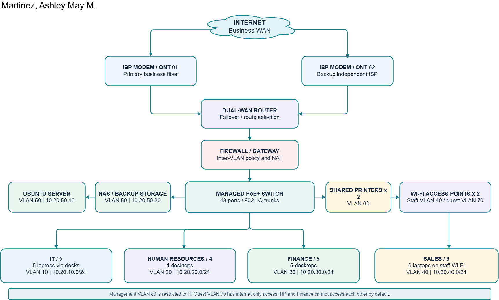

# Week 02 - Enterprise Infrastructure Planning for a Startup Company

**Course:** ITEP 414 - System Administration and Maintenance  
**Program:** Bachelor of Science in Information Technology  
**Institution:** Laguna State Polytechnic University  
**Prepared by:** Martinez, Ashley May M.  
**Section:** BSIT 4E  
**Date:** August 20, 2026  
 

## Project Overview

This project presents a proposed IT infrastructure plan for **ABC Startup Solutions**, a fictional software development startup with **20 employees in one office floor**. The organization has no computers, server, network, internet connectivity or established security policies. As the assigned Junior System Administrator, the objective is to define a realistic starting architecture before equipment purchase.

The proposed environment uses a departmental device allocation, one Linux application server, centralized endpoint management, independent primary and backup internet circuits, a managed segmented network, and controlled backup and recovery practices. Detailed specifications, justifications, IT role descriptions, and implementation recommendations appear in the full report.

**Full report:** [EnterpriseInfrastructurePlan.pdf](EnterpriseInfrastructurePlan.pdf)

## Learning Objectives

- Analyze business requirements and translate them into technical infrastructure decisions.
- Prepare professional inventories for employee hardware, business software and network devices.
- Create a readable enterprise network diagram with appropriate labels, segments and connections.
- Explain Helpdesk, Network, Linux System and Cloud Administrator responsibilities.
- Recommend practical internet, security, backup and growth strategies.
- Document technical decisions professionally in Markdown and PDF format.

## Company Scenario

**Company:** ABC Startup Solutions  
**Business:** Custom software development and digital solutions  
**Office:** Suite 5, Innovation Park Center, Santa Rosa City, Laguna (**fictional**)  
**Vision:** To be a trusted technology partner delivering dependable and accessible software solutions to growing businesses.  
**Mission:** To design and support secure, practical software solutions through skilled people, consistent service and responsible technology practices.

**Organizational structure:** Executive sponsor (management function) -> IT lead / HR lead / Finance lead / Sales lead -> respective employees. Department leads are part of the 20-person staffing allocation.

| Department | Employees | Main requirement |
| --- | --- | --- |
| Information Technology | 5 | Development laptops, Git, VMs and server management |
| Human Resources | 4 | Private employee records and stable desktops |
| Finance | 5 | Confidential finance data and restricted access |
| Sales | 6 | Mobile laptops, staff Wi-Fi and online collaboration |
| **TOTAL** | **20** | Four departments, shared infrastructure |

## Hardware Inventory Summary

| Equipment | Proposed quantity | Reason |
| --- | --- | --- |
| Desktop computers | 9 | HR (4), Finance (5) |
| Laptops | 11 | IT (5), Sales (6) |
| External monitors | 22 | 20 active, 2 spare |
| USB-C docks | 11 | Mobile workstations |
| Ubuntu application server | 1 | Internal services and staging |
| NAS storage | 1 | RAID 6 local storage and backup target |
| Router / firewall | 1 each | Dual-WAN resilience and policy enforcement |
| 48-port PoE+ managed switch | 1 | Core access and VLAN switching |
| Wi-Fi 6 access points | 2 | Staff and guest wireless |
| Printers | 2 | Shared, role-controlled printing |
| UPS units | 2 | Network and server protection |
| Encrypted external backup drives | 2 | Offline media rotation |

See **Part 2** of the [full report](EnterpriseInfrastructurePlan.pdf) for the complete asset IDs, specifications, departmental assignments and justification. Hardware and networking inventory listings cross-reference the same router, firewall, switch and AP units to avoid duplicate purchasing.

## Software Inventory Summary

| Software | Intended deployment |
| --- | --- |
| Windows 11 Pro | All 20 employee endpoints |
| Ubuntu Server 26.04 LTS | One application/server host |
| Microsoft Office / Microsoft 365 Apps | 20 Business Premium seats |
| VS Code, Git, GitHub Desktop | IT development and version control |
| VirtualBox | IT test and learning virtual machines |
| Google Chrome and 7-Zip | Standard endpoint utilities |
| Microsoft Defender | Managed endpoint security |
| AnyDesk | Commercial remote support (paid outgoing seats) |

The report includes a 12-row software inventory with planned versions/channels, licensing and business purpose. The Microsoft 365 Business Premium subscription is the proposed basis for Microsoft Office apps, Entra ID P1, Intune and Defender for Business. AnyDesk outbound business support requires paid licensing.

## Network Design

The logical topology includes the internet, two ISP modems, dual-WAN router, dedicated firewall, a 48-port managed PoE+ switch, shared printers, a server and NAS, two access points, and all four departments.

**Full-size files:** [PNG](diagrams/EnterpriseNetworkTopology.png) | [PDF](diagrams/EnterpriseNetworkTopology.pdf) | [Editable diagrams.net / Draw.io source](diagrams/EnterpriseNetworkTopology.drawio)

### VLAN Addressing Plan

| VLAN | Department / zone | Subnet |
| --- | --- | --- |
| 10 | Information Technology | 10.20.10.0/24 |
| 20 | Human Resources | 10.20.20.0/24 |
| 30 | Finance | 10.20.30.0/24 |
| 40 | Sales / staff Wi-Fi | 10.20.40.0/24 |
| 50 | Server / NAS | 10.20.50.0/24 |
| 60 | Printers | 10.20.60.0/24 |
| 70 | Guest Wi-Fi | 10.20.70.0/24 |
| 80 | Management | 10.20.80.0/24 |

**Network policy:** Segments are blocked from one another by default, with explicit allowances for approved services. Guest Wi-Fi is internet-only. Finance and HR do not have direct access to each other. Management access is restricted to authorized IT administrators.

## System Administration Roles

The report researches four relevant roles, including responsibilities, skills, tools, certification pathways and collaboration: **Helpdesk Technician, Network Administrator, Linux System Administrator and Cloud Administrator**. For this small organization, responsibilities can be allocated within the existing five-person IT team.

## Infrastructure Recommendations

- Request site-qualified business fiber proposals from Globe Business and PLDT Enterprise; compare reliability, upload performance, cost and support.
- Plan one 8-core/64 GB ECC Ubuntu Server host and one 4-bay NAS with tested backups.
- Use a 3-2-1 backup design with offline/offsite retention and periodic restore tests.
- Require MFA, managed endpoint security, least-privilege access, encryption and VLAN segmentation.
- Target **30 employees within 12-18 months** using unused switch capacity and scalable subscriptions.

These are planning targets, not confirmed equipment orders, ISP service commitments or deployment results.

## Technologies and Methods Used

- **GitHub / Markdown:** structured documentation and portfolio organization.
- **Diagrams.net (Draw.io):** editable network diagram delivered as `.drawio`, plus PNG and PDF exports.
- **IT planning:** asset inventory, VLAN/IP plan, software licensing review and resilience evaluation.
- **Research:** official vendor documentation, NIST cybersecurity guidance, and CISA backup guidance.

## Challenges Encountered

### 1. Allocating devices to four departments

The company has 20 employees but not all roles need the same equipment. The proposed solution is nine desktop computers for HR and Finance, and 11 laptops for IT and Sales, with 22 monitors and 11 docks to support office work and mobility.

### 2. Designing secure department-to-department access

A flat network would expose confidential departments unnecessarily. The design separates IT, HR, Finance, Sales, servers, printers, guest Wi-Fi and management into VLANs and uses a firewall to allow only approved cross-zone traffic.

### 3. Balancing resiliency with startup-scale resources

The organization needs reliable access and recoverable data without immediately buying a large enterprise platform. The plan proposes dual ISP links, UPS-protected equipment, a local NAS and an independent offsite/offline backup copy, with expansion options as the business grows.

## Personal Reflection (Draft - Review Before Submission)

This project helped me understand that system administration begins long before computers, servers, or network devices are installed. I learned how to translate a company's business requirements into a practical infrastructure plan. In the case of ABC Startup Solutions, the four departments have different needs even though they share one office. IT requires reliable development and administrative tools, Human Resources handles confidential employee information, Finance processes sensitive financial records, and Sales depends on fast communication and mobility. Recognizing these differences helped me understand why the same equipment or network permissions should not automatically be assigned to everyone.

The most challenging part of the project was creating a network design that remained simple enough for a small startup while still addressing security and future growth. At first, it seemed sufficient to connect all devices to one switch and wireless network. However, planning the VLANs, firewall rules, shared printer access, and separate guest Wi-Fi showed me how easily an unsegmented network could expose one department's information to another. I also had to balance the equipment quantities against real operational needs, such as purchasing enough laptops for mobile employees, choosing a switch with spare ports, and including backup power and storage instead of focusing only on computers.

I also learned the value of documentation in preventing confusion during deployment and maintenance. An inventory makes it easier to track assets and licenses, while a network topology shows how devices communicate. Planning a backup schedule, recovery targets, password policy, and administrator responsibilities before deployment gives the IT team a clearer basis for testing and responding to failures. Using reputable technical sources also reminded me that recommendations should be supported by established practices rather than personal assumptions.

As a fourth-year Information Technology student beginning to pursue Data Analytics, I can see how this activity connects to my broader professional goals. Reliable infrastructure, controlled access, and accurate documentation are necessary for protecting the data that organizations later analyze. This project strengthened my technical reasoning and showed me how to communicate decisions in a format that a manager could review. Moving forward, I want to develop these skills through practical configuration exercises and improve my ability to design systems that are secure, maintainable, and appropriate for the people using them.

## References

Source links, access notes and assumptions are available in [references/Sources.md](references/Sources.md). Relevant references include the official documentation from NIST, CISA, Microsoft, Ubuntu, Oracle, Linux Foundation, Red Hat, AWS, AnyDesk, Globe Business and PLDT Enterprise.

