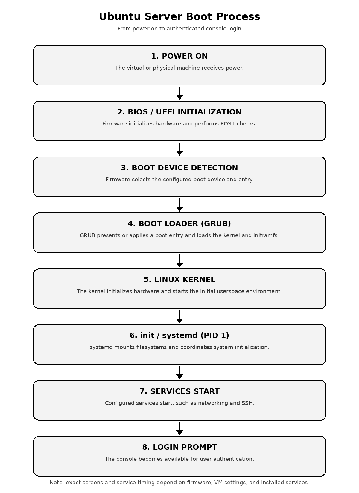

# Week 03 - Enterprise Server Deployment and Operating System Installation

**Course:** ITEP 414 - System Administration and Maintenance  
**Program:** BSIT  
**Student:** \[Your Full Name\]  
**Virtualization platform:** \[Oracle VirtualBox / VMware
Workstation\]  
**Status:** Working portfolio template - complete all bracketed fields
after the lab.

## Project Overview

This project documents the installation and initial verification of
Ubuntu Server in a virtual machine. The work includes configuring the
hostname, network, storage, and OpenSSH; verifying connectivity and
service status; comparing BIOS and UEFI; mapping the boot process;
installing Windows Server Evaluation; and comparing Windows Server,
Ubuntu Server, and Rocky Linux.

The documentation is designed to be reproducible. All results,
screenshots, VM details, and problems must reflect the student’s actual
lab environment.

## Learning Objectives

- Explain the purpose of an operating system in an enterprise
  environment.
- Differentiate BIOS and UEFI firmware and describe the boot process.
- Install Ubuntu Server in a virtual machine.
- Configure the hostname, networking, user account, storage, and SSH.
- Verify server operation using command-line tools.
- Compare Windows Server, Ubuntu Server, and Rocky Linux.
- Produce professional installation documentation and portfolio
  artifacts.

## Virtual Machine Specifications

| Component               | Required / actual value                                                  |
|-------------------------|--------------------------------------------------------------------------|
| VM name                 | `Ubuntu-Server-Week03`                                                   |
| RAM                     | 4 GB                                                                     |
| CPU                     | 2 virtual processors                                                     |
| Storage                 | 40 GB VDI/VMDK                                                           |
| Network                 | NAT unless instructed otherwise                                          |
| Hostname                | `server01`                                                               |
| Ubuntu ISO              | \[Record exact release and ISO filename\]                                |
| Firmware mode           | \[BIOS / UEFI - record actual setting\]                                  |
| Partition scheme        | \[Record actual layout\]                                                 |
| Filesystem(s)           | \[Record actual filesystem(s)\]                                          |
| IP address              | \[Record the assigned address; do not publish sensitive public details\] |
| Administrative username | \[Your username - never include password\]                               |

## Installation Summary

1.  Create the virtual machine with the required CPU, memory, storage,
    and network settings.
2.  Attach the approved Ubuntu Server LTS ISO.
3.  Select English and the appropriate keyboard layout.
4.  Accept DHCP unless instructed otherwise and record the assigned
    address.
5.  Use Guided - Use Entire Disk on the new 40 GB virtual disk only.
6.  Set hostname `server01` and create a non-root administrative user.
7.  Select **Install OpenSSH Server**.
8.  Complete installation, reboot, detach the ISO if necessary, and log
    in.
9.  Update the system and complete the verification tasks below.

## Configuration Summary

- **Hostname:** `server01`
- **Network mode:** \[NAT / Bridged\]
- **Addressing:** \[DHCP / other approved configuration\]
- **SSH:** \[Installed / not installed; record actual service state\]
- **System update date:** \[Date\]
- **Additional packages:** \[None / list only packages actually
  installed\]

## Verification Results

| Task                  | Command                                     | Actual result | Evidence                                | Status          |
|-----------------------|---------------------------------------------|---------------|-----------------------------------------|-----------------|
| Login                 | Log in at console                           | \[Fill in\]   | `screenshots/03_login.png`              | \[Pass / Fail\] |
| Hostname              | `hostname`                                  | \[Fill in\]   | `screenshots/04_hostname.png`           | \[Pass / Fail\] |
| IP address            | `ip addr`                                   | \[Fill in\]   | `screenshots/05_ip_addr.png`            | \[Pass / Fail\] |
| Internet connectivity | `ping -c 4 google.com`                      | \[Fill in\]   | `screenshots/06_ping_google.png`        | \[Pass / Fail\] |
| System update         | `sudo apt update` and `sudo apt upgrade -y` | \[Fill in\]   | `screenshots/07_apt_update_upgrade.png` | \[Pass / Fail\] |
| SSH service           | `systemctl status ssh`                      | \[Fill in\]   | `screenshots/08_ssh_status.png`         | \[Pass / Fail\] |

Do not mark a task as passed until it has been run and the output has
been checked. If ICMP is blocked by the network, document the limitation
and follow the instructor’s guidance.

## BIOS vs. UEFI Highlights

- Legacy BIOS is commonly associated with MBR booting and classic MBR
  layout limitations.
- UEFI provides a modern firmware interface and commonly works with GPT.
- GPT supports disks larger than 2 TiB; exact limits depend on
  implementation and operating-system support.
- UEFI can support Secure Boot when the feature is enabled and
  configured correctly.
- Boot time depends on firmware, devices, operating-system services, and
  configuration; UEFI is not automatically faster in every case.

See [`BIOS_vs_UEFI.pdf`](BIOS_vs_UEFI.pdf) for the comparison table and
discussion.

## Ubuntu Boot Process Flowchart

<figure>

<figcaption aria-hidden="true">Ubuntu Server Boot Process</figcaption>
</figure>

Sequence: Power On -\> BIOS/UEFI Initialization -\> Boot Device
Detection -\> GRUB -\> Linux Kernel -\> init/systemd -\> Services Start
-\> Login Prompt.

See [`BootProcessFlowchart.pdf`](BootProcessFlowchart.pdf) for the
printable version.

## Windows Server Evaluation Activity

- Edition/version: \[Record actual edition\]
- VM name: \[Record actual VM name\]
- CPU / RAM / storage: \[Record actual settings\]
- Computer name: \[Record actual hostname\]
- Login verified: \[Yes / No\]
- Updates completed: \[Yes / No\]
- Evidence: \[List filenames in `screenshots/`\]

Use the official Microsoft Evaluation Center and follow its current
terms. The Windows Server 2025 evaluation is listed as expiring after
180 days; do not treat an evaluation as a permanent production license.

## Operating System Comparison

The comparison considers licensing, user interface, package management,
security, performance, enterprise use cases, advantages, and
disadvantages. No single OS is best for every workload.

See [`OS_Comparison_Report.pdf`](OS_Comparison_Report.pdf).

## Challenges Encountered

Complete after performing the lab.

| Problem            | Evidence / error message | Cause     | Solution and re-test            |
|--------------------|--------------------------|-----------|---------------------------------|
| \[Actual issue 1\] | \[Exact message\]        | \[Cause\] | \[Actual fix and verification\] |
| \[Actual issue 2\] | \[Exact message\]        | \[Cause\] | \[Actual fix and verification\] |

## Reflection (300-500 words - draft template)

**Important:** Replace every bracketed instruction and revise this
reflection so it describes what actually happened in your lab. Do not
submit the placeholders.

Working on this project helped me understand that server deployment
involves more than installing an operating system. A server must be
configured consistently, checked with appropriate commands, secured for
its intended use, and documented so another administrator can repeat the
work. Before this activity, my understanding of server installation was
\[describe your prior knowledge or expectation\].

For the Ubuntu Server virtual machine, I used \[VirtualBox or VMware\]
and configured \[actual RAM\], \[actual virtual CPUs\], and \[actual
disk size\]. I selected \[actual Ubuntu release\], set the hostname to
`server01`, created a non-root administrative account, and \[describe
the storage layout and network configuration you observed\]. I also
selected or configured OpenSSH so the server could support remote
administration where the network permits it.

During verification, I used `hostname`, `ip addr`,
`ping -c 4 google.com`, `sudo apt update`, `sudo apt upgrade -y`, and
`systemctl status ssh`. The tests that passed were \[list actual
successful tests\]. The tests that needed further work were \[list any
failed or inconclusive tests\]. One challenge I encountered was
\[describe a real issue and include the relevant evidence\]. I addressed
it by \[describe the steps actually taken\] and confirmed the outcome by
\[describe the re-test\].

The BIOS and UEFI comparison helped me connect firmware settings with
boot behavior, partitioning, and security features such as Secure Boot.
The boot-process flowchart also showed how firmware, the boot loader,
the Linux kernel, systemd, and services contribute to a usable system.
Comparing Windows Server, Ubuntu Server, and Rocky Linux reinforced that
OS selection depends on workload requirements, compatibility, support,
licensing, and administrator skills rather than on a single universal
ranking.

My main lesson from this project is that clear documentation and honest
verification are essential parts of system administration. In future
work, I want to improve my ability to \[name a specific skill, such as
diagnosing DNS, managing SSH keys, or documenting storage layouts\].
Before submitting this portfolio, I will check that each screenshot is
genuine, every result matches my VM, and all bracketed fields have been
replaced.

## References

- Ubuntu Server installation:
  https://ubuntu.com/server/docs/installation/
- Ubuntu Server OpenSSH:
  https://ubuntu.com/server/docs/how-to/security/openssh-server/
- Ubuntu package management:
  https://ubuntu.com/server/docs/how-to/software/package-management/
- Ubuntu releases:
  https://ubuntu.com/project/docs/release-team/list-of-releases/
- UEFI Forum specifications: https://uefi.org/specifications
- Microsoft Windows Server 2025 Evaluation Center:
  https://www.microsoft.com/en-us/evalcenter/download-windows-server-2025
- Microsoft Windows Server release information:
  https://learn.microsoft.com/en-us/windows/release-health/windows-server-release-info
- Microsoft Secure Boot overview:
  https://learn.microsoft.com/en-us/windows-hardware/drivers/bringup/secure-boot
- Rocky Linux releases: https://docs.rockylinux.org/releases/
- Rocky Linux DNF documentation:
  https://docs.rockylinux.org/guides/package_management/dnf_package_manager/
- Oracle VM VirtualBox manual: https://www.virtualbox.org/manual/

Accessed 26 October 2026.
